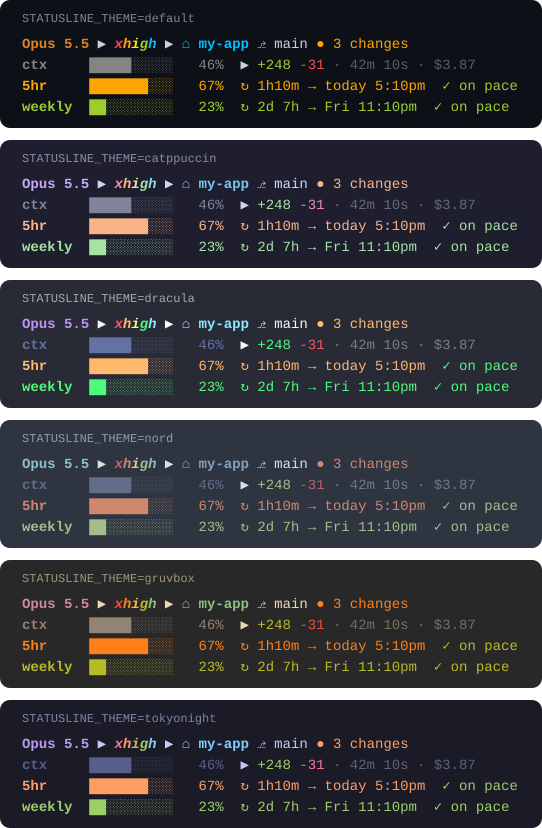

# claude-code-statusline

**Everything in 4 lines. One file. No plugins.**

A status line for [Claude Code](https://claude.com/claude-code) that tells you not just how much of your plan you've used, but **whether you'll run out before it resets**.

<p align="center"></p>

```bash
curl -fsSL https://raw.githubusercontent.com/daydeda/claude-code-statusline/main/install.sh | bash
```

## Features

- **Pace prediction:** projects your current burn rate to the reset time. `✓ on pace` means you'll make it; `⚠ runs out today 4:19pm` tells you exactly when you'll hit the wall. No history file, nothing running in the background.
- **Limits that warn you:** the 5-hour and weekly bars turn orange at 50% and red at 80%. From 90% the bar **pulses**, so you notice even when you're not looking at it.
- **Human-friendly reset times:** `↻ 1h10m → today 5:10pm`, `↻ 20h10m → tomorrow 1:00am`, `↻ 2d 7h → Fri 11:10pm`.
- **Effort at a glance:** `low` green, `medium` yellow, `high` red, and an **animated rainbow** for `xhigh` and `max`.
- **Where you are:** folder name (`⌂ my-app`) and git state in plain words (`⎇ main ✓ clean` or `● 3 changes`).
- **Session summary:** context window bar, lines added and removed, elapsed time and cost.
- **6 themes and 5 bar styles**, switchable with one line of config.
- **Fast and light:** one Bash script (works with the bash 3.2 on macOS), one `jq` call and one `git` call per refresh, about 0.1s.

## Themes

Set `STATUSLINE_THEME` in `~/.claude/statusline.conf`:

<p align="center"></p>

Bar styles (`STATUSLINE_BAR`): `blocks` █░ · `shade` ▓░ · `dots` ●○ · `slim` ▰▱ · `line` ━─

## Install

### As a plugin

In Claude Code:

```
/plugin install pace-statusline --marketplace daydeda/claude-code-statusline
/pace-statusline setup
```

Or from your shell:

```bash
claude plugin marketplace add daydeda/claude-code-statusline
claude plugin install pace-statusline@claude-code-statusline
```

then run `/pace-statusline setup` in Claude Code. The plugin keeps the status line up to date when it updates, and adds:

| Command | What it does |
| --- | --- |
| `/pace-statusline setup` | Turns it on. Your current status line is saved. |
| `/pace-statusline theme dracula` | Switches theme. |
| `/pace-statusline status` | Shows whether it's on and which theme is set. |
| `/pace-statusline remove` | Puts back the status line you had before. |

### With the one-line installer

```bash
curl -fsSL https://raw.githubusercontent.com/daydeda/claude-code-statusline/main/install.sh | bash
```

Then restart Claude Code. The installer:

1. downloads `statusline.sh` to `~/.claude/statusline.sh`,
2. creates `~/.claude/statusline.conf` with every option (an existing one is never overwritten),
3. backs up your `settings.json` as `settings.json.bak.<timestamp>`,
4. sets `statusLine` to run the script, refreshing every second (this drives the animations).

**Requirements:** `bash`, plus `jq` or `python3`. `git` is optional.

Prefer to read before you run? [`install.sh`](install.sh) is about 20 lines.

## Configure

Edit `~/.claude/statusline.conf`. Changes show up on the next refresh; no restart needed.

| Setting | Values | Default |
| --- | --- | --- |
| `STATUSLINE_THEME` | `default` `catppuccin` `dracula` `nord` `gruvbox` `tokyonight` | `default` |
| `STATUSLINE_BAR` | `blocks` `shade` `dots` `slim` `line` | `blocks` |
| `STATUSLINE_CLOCK` | `12` (5:10pm) or `24` (17:10) | `12` |
| `STATUSLINE_ANIMATE` | `1` on, `0` off (rainbow and pulse) | `1` |
| `STATUSLINE_SHOW_FOLDER` | `1` / `0` | `1` |
| `STATUSLINE_SHOW_GIT` | `1` / `0` | `1` |
| `STATUSLINE_SHOW_SESSION` | `1` / `0` (lines changed, time, cost) | `1` |
| `STATUSLINE_SHOW_LIMITS` | `1` / `0` (5-hour and weekly rows) | `1` |
| `STATUSLINE_SHOW_PACE` | `1` / `0` (pace prediction) | `1` |

Environment variables with the same names override the file. The config is read as plain `KEY=value` lines and never executed.

## How the pace prediction works

Claude Code reports how much of each limit you've used and when it resets. Since the window length is fixed (5 hours or 7 days), the script knows how far into the window you are. If you've used 92% of your 5-hour limit 3h50m in, you're burning about 24% an hour, and the remaining 8% lasts about 20 more minutes. That's earlier than the reset, so it shows `⚠ runs out today 4:19pm`. If your usage is below the share of the window that has passed, you're `✓ on pace`. Early in a window it stays quiet until there's enough data for a stable estimate.

## Make it yours: fork it

This status line is meant to be remixed, and everything lives in one readable file, [`statusline.sh`](statusline.sh).

1. Click **Fork** at the top of this page.
2. Clone your fork and point Claude Code at it:
   ```bash
   git clone https://github.com/<you>/claude-code-statusline.git
   ln -sf "$PWD/claude-code-statusline/statusline.sh" ~/.claude/statusline.sh
   ```
   Because it's a symlink, every edit shows up in your status line on the next refresh.
3. Tweak away:
   - **Add a theme:** copy one of the blocks under `# themes` and pick your colors (24-bit `R;G;B`). A new theme is a great first pull request.
   - **Change the layout:** lines are built at the bottom of the script, and each meter row is one `meter` call.
   - **Show a new field:** add it to the `jq` call under `# input` (and the Python fallback below it), then print it with `emit "<style>" "$value"`.
   - **Test without Claude Code:**
     ```bash
     echo '{"model":{"display_name":"Opus"},"context_window":{"used_percentage":42}}' | ./statusline.sh
     ```
   - **Regenerate the previews** after changing the look: `python3 scripts/render-preview.py`
4. Ship your own installer: `STATUSLINE_REPO=https://raw.githubusercontent.com/<you>/claude-code-statusline/main` makes `install.sh` download from your fork.

Made a theme or a new section? Open a pull request or share a screenshot in an issue. I'd love to see it.

## Uninstall

Plugin: run `/pace-statusline remove`, then `claude plugin uninstall pace-statusline`.

One-line installer: remove the `statusLine` entry from `~/.claude/settings.json` (or restore one of the `.bak` files), then delete `~/.claude/statusline.sh` and `~/.claude/statusline.conf`.

## License

[MIT](LICENSE). Use it, fork it, ship it.
